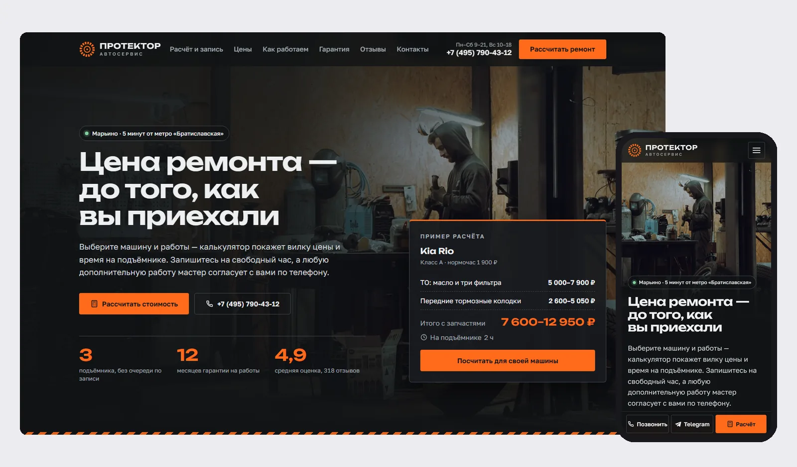
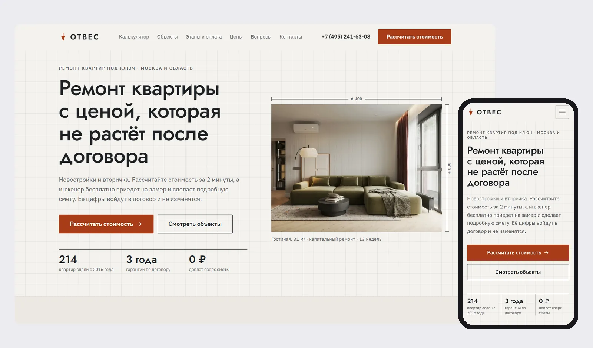
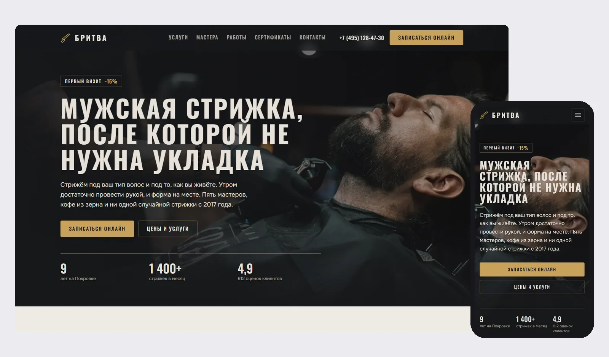
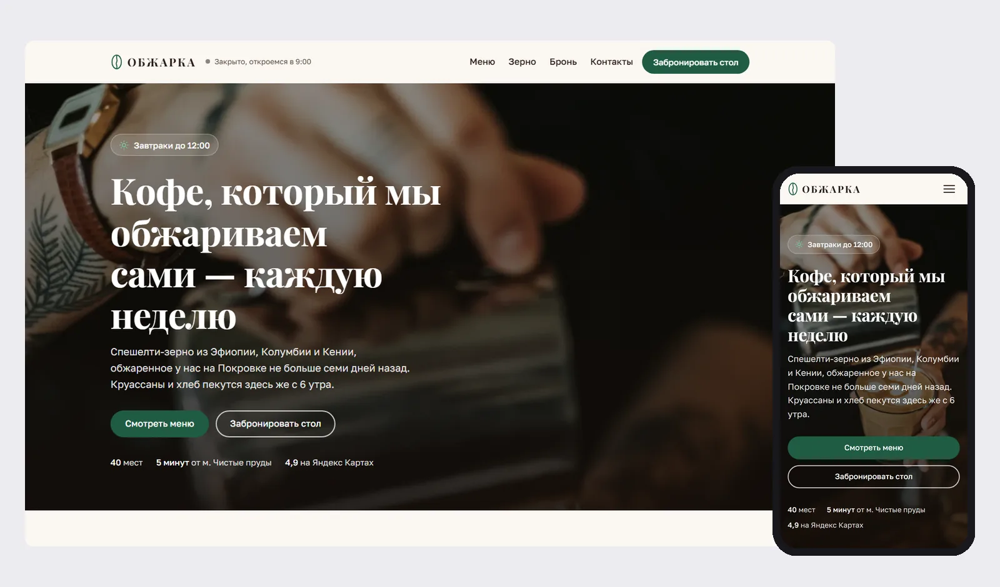

## Павел Анисимов — сайты для малого бизнеса

Делаю сайты для кофеен, салонов, мастеров, автосервисов и ремонтных бригад. Главная задача каждого сайта — чтобы клиент сам записался или оставил заявку, а вам пришло сообщение в Telegram.

**Связаться:** Telegram [@p4yLa](https://t.me/p4yLa)

### Что делаю

- **Сайт-визитка или лендинг.** Услуги, цены, фото работ, отзывы, контакты. Удобно с телефона, быстро грузится.
- **Онлайн-запись.** Клиент выбирает услугу и свободное время, двойной записи на одно время не будет. Заявка приходит вам в Telegram.
- **Калькулятор или квиз.** Клиент сам видит примерную цену и оставляет заявку. Подходит для рекламы в Яндекс Директе.
- **Под российские правила.** Согласие на обработку персональных данных по 152-ФЗ, политика конфиденциальности, шрифты без Google, Яндекс Метрика и Карты.

### Работы

Все проекты — демо: компании, имена, телефоны и отзывы вымышлены. Сайты рабочие, их можно открыть и потыкать.

<table>
<tr>
<td width="50%" valign="top">

<b><a href="https://p4yla.github.io/mindal-nails/">«Миндаль»</a></b> — мастер маникюра, принимает дома 
Запись в свободные окна с учётом длительности процедур и перерывов. Точный адрес и домофон клиентка получает только после записи. 
<a href="https://github.com/p4yLa/mindal-nails">код</a>

</td>
<td width="50%" valign="top">

<b><a href="https://p4yla.github.io/protektor-autoservice/">«Протектор»</a></b> — автосервис 
Калькулятор: марка → модель → работы, сразу видна цена и время на подъёмнике. Запись на свободный пост. 
<a href="https://github.com/p4yLa/protektor-autoservice">код</a>

</td>
</tr>
<tr>
<td width="50%" valign="top">

<b><a href="https://p4yla.github.io/otves-remont/">«Отвес»</a></b> — ремонт квартир под ключ 
Квиз из 7 шагов считает вилку цены и срок, дальше заявка на замер. Слайдер «до/после», пример сметы. 
<a href="https://github.com/p4yLa/otves-remont">код</a>

</td>
<td width="50%" valign="top">

<b><a href="https://p4yla.github.io/britva-barbershop/">«Бритва»</a></b> — барбершоп 
Запись к мастеру по реальному расписанию, заявки приходят в Telegram-бот. Подарочные сертификаты. 
<a href="https://github.com/p4yLa/britva-barbershop">код</a>

</td>
</tr>
<tr>
<td width="50%" valign="top">

<b><a href="https://p4yla.github.io/obzharka-coffee/">«Обжарка»</a></b> — кофейня 
Меню с переключением объёма, бронь стола по часам работы, статус «открыто/закрыто», галерея. 
<a href="https://github.com/p4yLa/obzharka-coffee">код</a>

</td>
<td width="50%" valign="top">
</td>
</tr>
</table>

### Как устроены сайты

HTML, CSS и JavaScript без конструкторов: код сайта целиком ваш и не привязан к тарифу Tilda или Wix. Заявки и запись работают через Cloudflare Workers и Telegram-бота. Каждый сайт проверяю на телефоне и компьютере, замеряю скорость в Lighthouse и доступность в axe.
